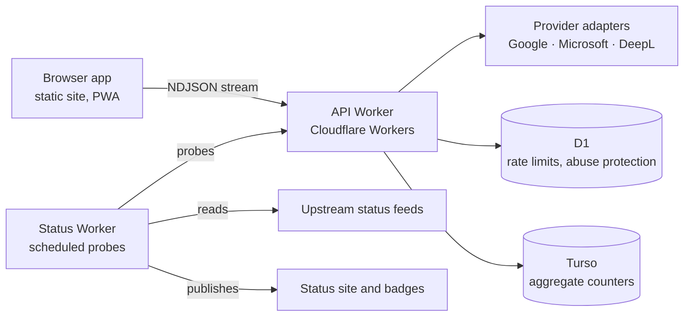

# Montage Subtitle Translator

**Free, browser-based subtitle translation with scene-level context and timing-safe cue restoration.**

<div align="right">

**English | [简体中文](./docs/github/README.zh-Hans.md) | [繁體中文](./docs/github/README.zh-Hant.md)**

</div><br/>

<div align="center">

| [Open the Tool](https://subs.js.org/subtitle-translator/) | [Service Status](https://status.translate.sub.qzz.io) | [Report an Issue](https://github.com/MontageSubs/subtitle-translator/issues) | [Discussions](https://github.com/MontageSubs/subtitle-translator/discussions) |
| :---: | :---: | :---: | :---: |

[](https://status.translate.sub.qzz.io)
[](https://status.translate.sub.qzz.io)
[](https://status.translate.sub.qzz.io)
[](https://status.translate.sub.qzz.io)

</div><br/>

## Overview

Montage Subtitle Translator is an open-source web service built by the MontageSubs community. It translates SRT, VTT and ASS/SSA files between 200+ languages using neural machine translation (NMT) engines, and writes the result back onto the original timeline.

It exists to fill a gap in our own workflow: manual subtitling takes weeks per title, and line-by-line machine translation loses too much context to be readable. This project is not a replacement for human translation. It aims to produce a structurally correct, readable draft quickly.

Why NMT instead of an LLM: a typical subtitle file has around 1,500 cues, and running that volume through an LLM for every user is not affordable for a free, non-profit service. Most of the engineering effort goes into two problems: giving the engine scene-level context, and restoring the translated text onto the original cues.

## How It Works

Translating cue by cue breaks sentences that span several cues, and the engine never sees the scene. The pipeline works around this in four steps:

1. **Parse and normalize.** The browser parses SRT, VTT or ASS, separates timing, style tags and text, and detects the source language.
2. **Merge and pack.** Cues that belong to one sentence are merged into natural text, then grouped by scene into batches. Each batch carries cue markers.
3. **Translate.** The Worker sends batches to a provider adapter and streams progress back to the client as NDJSON.
4. **Restore.** The translated text is split back onto the original cues using the markers. Where markers are damaged, repair and retry strategies take over. Languages without word boundaries (Chinese, Japanese) use dictionary-based segmentation to choose split points.

Glossary terms, optional background notes, line wrapping rules and bilingual stacking are applied around this core.

Known limitations:

- Restoration is heuristic. Unusual sentence structures can still produce misplaced splits or untranslated fragments.
- Quality varies by language pair and by provider.
- ASS output is regenerated from parsed events. Complex typesetting should be checked manually.

## Architecture



| Component | Path | Stack | Responsibility |
| :--- | :--- | :--- | :--- |
| Web app | `app/` | TypeScript, Vite, no UI framework | Parsing, rendering, history, i18n, docs, prerendered static pages |
| API Worker | `workers/api/` | Cloudflare Workers, D1 | Packing, provider calls, marker parsing and recovery, abuse protection |
| Status Worker | `workers/status/` | Cloudflare Workers, cron | Probes, incident arbitration, status pages, badges |
| Docs | `docs/` | Markdown, three locales | Rendered into the site at build time |
| CI/CD | `.github/workflows/` | GitHub Actions | Deployment, database and secret maintenance |

The browser app is deployed to GitHub Pages. Both Workers are deployed with Wrangler from GitHub Actions.

## Repository Structure

```
subtitle-translator/
├── app/
│   ├── src/
│   │   ├── api/translation/        # Streaming protocol client, retries, access challenge
│   │   ├── components/             # UI components
│   │   ├── lib/subtitle/
│   │   │   ├── formats/            # srt/, vtt/, ass/ parsers and renderers
│   │   │   ├── language/           # Script families, language resolution
│   │   │   ├── postprocess/        # Line wrapping and display text
│   │   │   └── extraction/         # Encoding detection and text extraction
│   │   ├── lib/history/            # Local translation history
│   │   ├── pages/                  # Translator, history, docs, tools, about, contribute
│   │   ├── render/                 # Prerendering of static pages
│   │   └── i18n/locales/           # en, zh-Hans, zh-Hant
│   ├── scripts/                    # Prerender, i18n audit, build manifest
│   └── vite-plugins/               # Docs pipeline, sitemap, web manifest
├── workers/
│   ├── api/src/
│   │   ├── translation/engine/     # Packing, chapters, cue chunks, marker repair, recovery
│   │   ├── translation/providers/  # google/, microsoft/, deepl/ and registry
│   │   └── http/                   # NDJSON streaming, protocol, output guard
│   └── status/src/
│       ├── monitoring/             # Probes and upstream status readers
│       ├── arbitration/            # Component status and incident decisions
│       └── publish/                # Static pages, assets, republish
├── docs/                           # User-facing documents (en, zh-Hans, zh-Hant)
│   └── github/                     # Localized READMEs, never published to the site
└── .github/workflows/
```

## Service Monitoring

The status site is generated by `workers/status`. A scheduled cycle collects probe results and upstream feeds, arbitrates a status per component, publishes static pages and updates incident history.

- Status page: <https://status.translate.sub.qzz.io>
- Badge gallery: <https://status.translate.sub.qzz.io/badges/>
- Machine-readable snapshot: <https://status.translate.sub.qzz.io/status.json>

Planned maintenance is declared in [`workers/status/MAINTENANCE.md`](./workers/status/MAINTENANCE.md). Error codes shared by the API and the monitor are listed in [`workers/status/docs/ERROR_CODES.md`](./workers/status/docs/ERROR_CODES.md).

## Local Development

Requirements: Node.js 22 or later.

```bash
git clone https://github.com/MontageSubs/subtitle-translator.git
cd subtitle-translator/app
npm ci
npm run dev
```

| Command | Purpose |
| :--- | :--- |
| `npm run dev` | Vite dev server |
| `npm run typecheck` | TypeScript check |
| `npm run i18n:check` | Verifies key parity, placeholders and plural forms across locales |
| `npm run build` | Typecheck, i18n audit, bundle, prerender, build manifest |

Workers:

```bash
cd workers/api      # or workers/status
npm ci
npm run typecheck
npm run dev         # wrangler dev
```

`wrangler.toml` contains a placeholder for the D1 database id. Secrets and provider credentials are configured through Wrangler or GitHub Actions secrets and are not part of the repository, so a local Worker run needs your own bindings.

Before opening a pull request, run `npm run build` in `app/` and `npm run typecheck` in any Worker you changed.

## Contributing

Areas where help is most useful:

- **Language handling.** Script families live in `app/src/lib/subtitle/language/families/`. Segmentation and line wrapping rules for more languages are welcome, especially with real subtitle samples that fail today.
- **Restoration bugs.** Reports with the source file, target language, a screenshot of the settings and the translation log are the most actionable. See the [feedback guide](./docs/feedback/en.md).
- **Providers.** An adapter implements the `TranslationProvider` interface and is registered in `workers/api/src/translation/providers/registry.ts`.
- **Localization.** UI strings are in `app/src/i18n/locales/`. `npm run i18n:check` reports missing keys and placeholder mismatches.
- **Documentation.** Markdown under `docs/` is rendered by a GitHub-flavored pipeline. Each document has one file per locale, listed in `docs/manifest.yml`.
- **Status monitoring.** Probes, upstream readers and incident templates in `workers/status/`.

Please open an issue before starting a large change. The full list of ways to help is in the [contribution guide](./docs/contribute/en.md). How user data is handled is described in the [privacy policy](./docs/privacy/en.md).

## License

[MIT](./LICENSE)

---

<div align="center">

**MontageSubs Community**  
"Powered by Love ❤️"

</div>