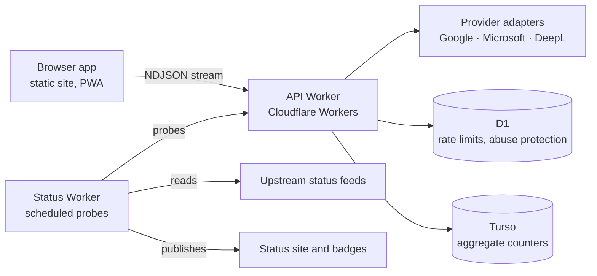

# Montage Subtitle Translator

**Free, open-source online subtitle translator for SRT, VTT and ASS files, built by the MontageSubs community.**

<div align="right">

**English | [简体中文](./docs/github/readme/zh-Hans.md) | [繁體中文](./docs/github/readme/zh-Hant.md)**

</div><br/>

<div align="center">

| [Open the Tool](https://subs.js.org/subtitle-translator/) | [Report an Issue](https://github.com/MontageSubs/subtitle-translator/issues) | [Discussions](https://github.com/MontageSubs/subtitle-translator/discussions) |
| :---: | :---: | :---: |


</div><br/>

## Overview

Montage Subtitle Translator is a free, open-source, no-sign-up subtitle translator built by the MontageSubs community. It translates SRT, VTT and ASS/SSA files between 200+ languages with neural machine translation (NMT), one scene at a time, and writes the result back onto the original timestamps.

It exists to fill a gap in our own workflow: manual subtitling takes weeks per title, and line-by-line machine translation loses too much context to be readable. This project is not a replacement for human translation. It aims to produce a structurally correct, readable draft quickly.

Our aim is subtitle translation that is high quality, fast and cheap enough to stay free. After evaluating the options, we found NMT to be the best fit today, and we've built a great deal of optimization around it to keep the output quality up. That is where most of this project's code lives.

## How It Works

Translating cue by cue breaks sentences that span several cues and strips away the context of the scene. The pipeline works around this in four steps:

1. **Parse and normalize.** The browser parses SRT, VTT or ASS, separates timing, style tags and text, and detects the source language.
2. **Merge and pack.** Cues that belong to one sentence are merged into natural text, then grouped by scene into batches. Each batch carries cue markers.
3. **Translate.** The Worker sends batches to a provider adapter and streams progress back to the client as NDJSON.
4. **Restore.** The translated text is split back onto the original cues using the markers. Where markers are damaged, repair and retry strategies take over. Languages without word boundaries (Chinese, Japanese) use dictionary-based segmentation to choose split points.

Glossary terms, optional background notes, line wrapping rules and bilingual stacking are applied around this core.

## What We Built

A translation engine hands back text. Turning that into a subtitle file people can actually watch is the hard part, and it's where most of our effort went. These pieces are our own work, and all of them are open source.

### Scene-level translation

Cues are first merged into complete sentences using trailing punctuation, quote state, dialogue dashes, music lines and continuation cues. The sentences are then packed into scenes by the gaps between timestamps, and each scene goes to the engine as one continuous passage. Timing and styling never reach the engine, only text and light cue markers. A slider in the app sets how finely scenes are cut. Different films and shows suit different settings, so you can find the balance that works best for yours.

### A glossary engines have to obey

Many NMT engines ignore glossaries, or honor them only in some API versions. We protect terms with markers so they survive the round trip, and your translation lands in the output exactly as you wrote it. A term that makes up a whole cue is resolved directly. Glossaries can be case-sensitive, imported and exported, and reused from earlier jobs in your local history.

### Names recognized on your device

For language pairs where names are written differently, such as English to Chinese, Japanese or Russian, the app can find character and place names before translating. A small named-entity model runs in your browser through ONNX Runtime Web, on WebGPU where available, together with a lexicon built from subtitle text. Recognition has seven depth levels, can be paused and resumed from a checkpoint, and uses speaker lines as extra hints. The names it finds are translated in one batch and handed to you as a glossary to review. The models are optional downloads, managed on the Models page.

### Putting translations back on the original cues

The engine returns long sentences, and each one has to be cut into pieces that fit the original cues. Cuts follow the cue markers when they survive. Otherwise the original punctuation is aligned against the translation with a sequence alignment, weighted by display width so full-width and half-width text divide fairly. Numbers with units, quoted speech, book titles, style tags, brackets and glossary terms are protected spans that a cut can't split. Cues that end up too heavy or too light are rebalanced, and line break rules keep forbidden characters off the start and end of a line. For Chinese and Japanese, dictionary-based word cutters choose the split points.

### A pipeline that repairs itself

Engines mangle things. They drop markers, add spaces inside them, leave source text behind, or let untranslated fragments slip into the output. Every response is validated, and damaged markers are repaired in place. Whatever can't be repaired goes through staged recovery: missing cues first, then untranslated ones, then suspect passages retried with shrinking context windows, then single cues, and finally leftover source-language fragments. Retries run speculatively in parallel.

## Features

- **Input.** SRT, VTT, ASS and SSA, several files, a folder or a ZIP at once, and automatic encoding detection. Subtitles can be read straight out of MKV videos in your browser, and the video itself is never uploaded.
- **Source cleanup.** Bilingual files can be split to the language you want, multi-track files let you pick a variant, and SDH annotations can be stripped while lyrics stay in their original language.
- **Output.** Single-language or bilingual output with your choice of stacking order and cue layout, styled ASS with fonts chosen per platform, language-specific punctuation, spacing and line breaking, and bidirectional protection for right-to-left text.
- **Review.** A side-by-side comparison, a cue editor with find and replace and undo, and automatic flags for missing translations, source text left behind, overlong lines and reading speeds that are too fast, using per-language thresholds.
- **Your data.** History and downloaded models stay in your browser. The interface comes in 30 languages and installs as a PWA.

## Known Limitations

- Restoration is heuristic. Unusual sentence structures can still produce misplaced splits or untranslated fragments.
- Quality varies by language pair and by provider.
- ASS output is regenerated from parsed events. Complex typesetting should be checked manually.

## Architecture



| Component | Path | Stack | Responsibility |
| :--- | :--- | :--- | :--- |
| Web app | `app/` | TypeScript, Vite, no UI framework | Parsing, rendering, history, i18n, docs, prerendered static pages |
| API Worker | `workers/api/` | Cloudflare Workers, D1 | Packing, provider calls, marker parsing and recovery, abuse protection |
| Status Worker | `workers/status/` | Cloudflare Workers, cron | Probes, incident arbitration, status pages, badges |
| Docs | `docs/` | Markdown, three locales | Rendered into the site at build time |
| CI/CD | `.github/workflows/` | GitHub Actions | Deployment, database and secret maintenance |

The browser app is deployed to GitHub Pages. Both Workers are deployed with Wrangler from GitHub Actions.


## Repository Structure

```
subtitle-translator/
├── app/
│   ├── src/
│   │   ├── api/translation/        # Streaming protocol client, retries, access challenge
│   │   ├── components/             # UI components, including the review and editing modal
│   │   ├── lib/subtitle/
│   │   │   ├── formats/            # srt/, vtt/, ass/ parsers and renderers
│   │   │   ├── container/matroska/ # In-browser MKV subtitle extraction
│   │   │   ├── language/           # Script families, language rules, SDH patterns
│   │   │   ├── bilingual/          # Bilingual detection and side splitting
│   │   │   ├── variants/           # Multi-track variants, SDH inference
│   │   │   ├── sentence/           # Sentence merging on the client
│   │   │   ├── postprocess/        # Line wrapping, typography, bidi protection
│   │   │   └── extraction/         # Encoding detection and text extraction
│   │   ├── lib/entities/           # On-device name recognition and term planning
│   │   ├── lib/models/             # Optional model downloads, runtimes, storage
│   │   ├── lib/history/            # Local translation history
│   │   ├── model-catalog/          # Model descriptors
│   │   ├── pages/                  # Translator, history, models, docs, tools, about, contribute
│   │   ├── render/                 # Prerendering of static pages
│   │   └── i18n/locales/           # 30 interface languages
│   ├── scripts/                    # Prerender, i18n audit, build manifest
│   ├── version.json                # Single source of the app version
│   └── vite-plugins/               # Channel, service worker, 404 page, docs pipeline, sitemap, web manifest
├── workers/
│   ├── api/src/
│   │   ├── subtitle/extract/       # Sentence merging, scene units, glossary extraction
│   │   ├── subtitle/merge/         # Anchors, cut resolution, translation splitting, rebalancing
│   │   ├── translation/engine/     # Packing, chapters, cue chunks, glossary markers, marker repair, recovery
│   │   ├── translation/terms/      # Translation of recognized names and terms
│   │   ├── translation/providers/  # google/, microsoft/, deepl/ and registry
│   │   └── http/                   # NDJSON streaming, protocol, output guard
│   └── status/src/
│       ├── monitoring/             # Probes and upstream status readers
│       ├── arbitration/            # Component status and incident decisions
│       └── publish/                # Static pages, assets, republish
├── docs/                           # User-facing documents (en, zh-Hans, zh-Hant)
│   └── github/readme/              # Localized READMEs, never published to the site
└── .github/workflows/
```

## Release Channels

`main` builds the production channel and `beta` builds the beta channel from the same source. The channel is decided at build time by `APP_CHANNEL`, never by the branch name. One Pages deployment contains both builds: production at the site root and beta under `beta/`.

Each channel has its own storage namespace (`localStorage`, `sessionStorage`, IndexedDB), its own service worker scope and its own cache, so updates, rollbacks and user data never cross channels. Beta builds report their version as `<version>-beta` and show a blue heart in the footer; five quick clicks on the heart switch between channels. Beta pages are `noindex`, absent from the sitemap and not linked from production pages.

Deployments run from `main` and always publish both channels. A push to `main` or `beta` that touches `app/` first bumps that branch's `app/version.json` and commits it back with a `Source:` reference, then deploys; a push to `beta` hands the deployment to `main`, the only branch the `github-pages` environment accepts. Production assets are content-hashed and the build is deterministic, so a beta-only change does not make production users update. A failing beta build leaves production deployed and turns the run red.

## Service Monitoring

The status site is generated by `workers/status`. A scheduled cycle collects probe results and upstream feeds, arbitrates a status per component, publishes static pages and updates incident history.

- Status page: <https://status.sub.qzz.io>
- Badge gallery: <https://status.sub.qzz.io/badges/>
- Machine-readable snapshot: <https://status.sub.qzz.io/status.json>

Planned maintenance is declared in [`workers/status/MAINTENANCE.md`](./workers/status/MAINTENANCE.md). Error codes shared by the API and the monitor are listed in [`workers/status/docs/ERROR_CODES.md`](./workers/status/docs/ERROR_CODES.md).

## Local Development

Requirements: Node.js 22 or later.

```bash
git clone https://github.com/MontageSubs/subtitle-translator.git
cd subtitle-translator/app
npm ci
npm run dev
```

| Command | Purpose |
| :--- | :--- |
| `npm run dev` | Vite dev server |
| `npm run typecheck` | TypeScript check |
| `npm run i18n:check` | Verifies key parity, placeholders and plural forms across locales |
| `npm run build` | Typecheck, i18n audit, bundle, prerender, build manifest for the channel in `APP_CHANNEL` (default `production`, output `dist/`) |
| `APP_CHANNEL=beta npm run build` | Beta channel build, output `dist-beta/`, served under `<base>/beta/` |

Workers:

```bash
cd workers/api      # or workers/status
npm ci
npm run typecheck
```

The Workers carry no deployment values. CI renders the Wrangler configuration from repository secrets at deploy time.

Before opening a pull request, run `npm run build` in `app/` and `npm run typecheck` in any Worker you changed.

## Contributing

We'd love to have you. The project is MIT licensed, and every part of it is open: the app, the translation engine, the status monitor and the docs. Areas where help is most useful:

- **Language handling.** Script families live in `app/src/lib/subtitle/language/families/`. Segmentation and line wrapping rules for more languages are welcome, especially with real subtitle samples that fail today.
- **Restoration bugs.** Reports with the source file, target language, a screenshot of the settings and the translation log are the most actionable. See the [feedback guide](./docs/feedback/en.md).
- **Providers.** An adapter implements the `TranslationProvider` interface and is registered in `workers/api/src/translation/providers/registry.ts`.
- **Localization.** The interface is translated on [Weblate](https://hosted.weblate.org/projects/subtitle-translator/web-interface/) and [Crowdin](https://crowdin.com/project/montage-subtitle-translator), so you can help without touching code. We're grateful to both platforms for supporting open-source projects. The [Localization Guide](./docs/localization/en.md) explains how to get started.
- **Documentation.** Markdown under `docs/` is rendered by a GitHub-flavored pipeline. Each document has one file per locale, listed in `docs/manifest.yml`.
- **Status monitoring.** Probes, upstream readers and incident templates in `workers/status/`.

Please open an issue before starting a large change. The full list of ways to help is in [How to Contribute](./docs/contribute/en.md), and you're welcome to drop into the [community](./docs/community/en.md) with questions. How user data is handled is described in the [privacy policy](./docs/privacy/en.md), and accessibility reports are welcome too, see the [accessibility statement](./docs/accessibility/en.md). Everyone taking part is expected to follow the [Code of Conduct](./docs/code-of-conduct/en.md), and security issues should be reported privately as described in the [Security Disclosure Guide](./docs/security/en.md).

## License

[MIT](./LICENSE)

---

<div align="center">

**MontageSubs Community**  
"Powered by Love ❤️"

</div>
