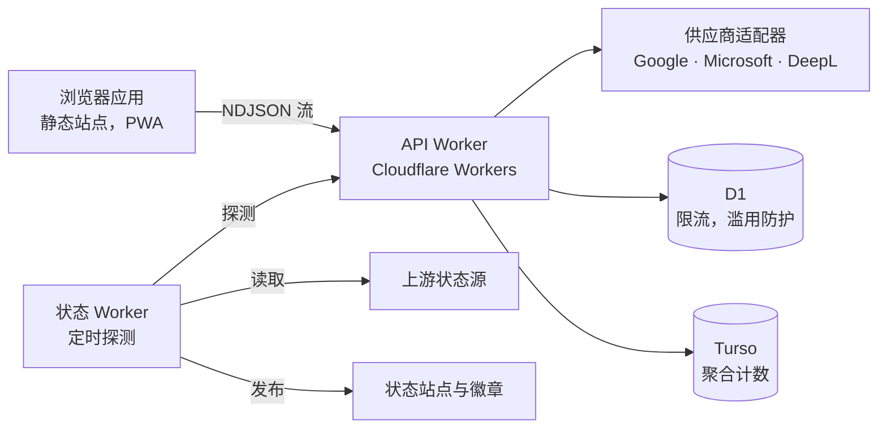

# 蒙太奇字幕翻译器

**免费的浏览器端字幕翻译服务：按场景组织上下文，翻译后精确还原到原有时间轴。**

<div align="right">

**[English](../../README.md) | 简体中文 | [繁體中文](./README.zh-Hant.md)**

</div><br/>

<div align="center">

| [打开工具](https://subs.js.org/subtitle-translator/) | [服务状态](https://status.translate.sub.qzz.io) | [反馈问题](https://github.com/MontageSubs/subtitle-translator/issues) | [参与讨论](https://github.com/MontageSubs/subtitle-translator/discussions) |
| :---: | :---: | :---: | :---: |

[](https://status.translate.sub.qzz.io)
[](https://status.translate.sub.qzz.io)
[](https://status.translate.sub.qzz.io)
[](https://status.translate.sub.qzz.io)

</div><br/>

## 项目简介

蒙太奇字幕翻译器是由蒙太奇字幕社区开发的开源 Web 服务，支持 SRT、VTT、ASS/SSA 文件，基于神经机器翻译（NMT）引擎在 200 多种语言之间互译，并把译文还原到原有时间轴上。

这个项目源自我们自己的字幕制作流程：纯手工制作一部作品往往需要数周，而逐行机翻丢失上下文，译文很难读。因此它不是人工精译的替代品，目标是在没有精译时，尽快得到一份结构正确、可以阅读的译本。

选择 NMT 而不是大语言模型（LLM）的原因是成本：一个字幕文件平均约 1,500 行，对每位用户都走 LLM，对于免费、非营利的服务来说负担不起。大部分工程投入集中在两个问题上：让引擎获得场景级上下文，以及把译文还原到原有的字幕条目上。

## 工作原理

逐条翻译会切断跨越多条字幕的句子，引擎也看不到场景。处理流程分为四步：

1. **解析与规范化。** 浏览器解析 SRT、VTT 或 ASS，分离时间轴、样式标签与文本，并检测源语言。
2. **合并与打包。** 属于同一句话的字幕被合并成自然语句，再按场景分组打包为批次，每个批次带有字幕条目标记。
3. **翻译。** Worker 将批次交给翻译供应商适配器，并以 NDJSON 流把进度回传给前端。
4. **还原。** 根据标记把译文重新切分回原有的字幕条目。标记受损时，由修复与重试策略接手。对于没有词边界的语言（中文、日文），使用词典分词来选择切分位置。

术语表、可选的背景说明、换行规则和双语排列都围绕这条主流程应用。

已知局限：

- 还原基于启发式规则，遇到特殊句式时仍可能出现错位切分或遗漏翻译。
- 翻译质量因语言对和供应商而异。
- ASS 输出由解析后的事件重新生成，复杂特效排版需要人工检查。

## 架构



| 组成部分 | 路径 | 技术栈 | 职责 |
| :--- | :--- | :--- | :--- |
| Web 应用 | `app/` | TypeScript、Vite，不使用 UI 框架 | 解析、渲染、历史记录、国际化、文档、预渲染静态页面 |
| API Worker | `workers/api/` | Cloudflare Workers、D1 | 打包、调用供应商、标记解析与恢复、滥用防护 |
| 状态 Worker | `workers/status/` | Cloudflare Workers、cron | 探测、事件裁定、状态页面、徽章 |
| 文档 | `docs/` | Markdown，三种语言 | 构建时渲染进站点 |
| CI/CD | `.github/workflows/` | GitHub Actions | 部署、数据库与密钥维护 |

前端部署在 GitHub Pages，两个 Worker 通过 GitHub Actions 使用 Wrangler 部署。

## 仓库结构

```
subtitle-translator/
├── app/
│   ├── src/
│   │   ├── api/translation/        # 流式协议客户端、重试、访问校验
│   │   ├── components/             # UI 组件
│   │   ├── lib/subtitle/
│   │   │   ├── formats/            # srt/、vtt/、ass/ 解析与渲染
│   │   │   ├── language/           # 文字体系分类、语言识别
│   │   │   ├── postprocess/        # 换行与显示文本
│   │   │   └── extraction/         # 编码检测与文本提取
│   │   ├── lib/history/            # 本地翻译历史
│   │   ├── pages/                  # 翻译器、历史、文档、工具、关于、贡献
│   │   ├── render/                 # 静态页面预渲染
│   │   └── i18n/locales/           # en、zh-Hans、zh-Hant
│   ├── scripts/                    # 预渲染、i18n 审计、构建清单
│   └── vite-plugins/               # 文档管线、站点地图、Web Manifest
├── workers/
│   ├── api/src/
│   │   ├── translation/engine/     # 打包、章节、字幕分块、标记修复、恢复
│   │   ├── translation/providers/  # google/、microsoft/、deepl/ 与注册表
│   │   └── http/                   # NDJSON 流、协议、输出校验
│   └── status/src/
│       ├── monitoring/             # 探测与上游状态读取
│       ├── arbitration/            # 组件状态与事件裁定
│       └── publish/                # 静态页面、资源、重新发布
├── docs/                           # 面向用户的文档（en、zh-Hans、zh-Hant）
│   └── github/                     # 多语言 README，不会发布到站点
└── .github/workflows/
```

## 服务监控

状态站点由 `workers/status` 生成。定时周期会收集探测结果和上游状态源，为每个组件裁定状态，发布静态页面并更新事件历史。

- 状态页面：<https://status.translate.sub.qzz.io>
- 徽章列表：<https://status.translate.sub.qzz.io/badges/>
- 机器可读快照：<https://status.translate.sub.qzz.io/status.json>

计划内维护在 [`workers/status/MAINTENANCE.md`](../../workers/status/MAINTENANCE.md) 中声明。API 与监控共用的错误码见 [`workers/status/docs/ERROR_CODES.md`](../../workers/status/docs/ERROR_CODES.md)。

## 本地开发

环境要求：Node.js 22 或更高版本。

```bash
git clone https://github.com/MontageSubs/subtitle-translator.git
cd subtitle-translator/app
npm ci
npm run dev
```

| 命令 | 作用 |
| :--- | :--- |
| `npm run dev` | 启动 Vite 开发服务器 |
| `npm run typecheck` | TypeScript 类型检查 |
| `npm run i18n:check` | 校验各语言的键、占位符与复数形式是否一致 |
| `npm run build` | 类型检查、i18n 审计、打包、预渲染、生成构建清单 |

Worker：

```bash
cd workers/api      # 或 workers/status
npm ci
npm run typecheck
npm run dev         # wrangler dev
```

`wrangler.toml` 中的 D1 数据库 ID 是占位符。密钥与供应商凭据通过 Wrangler 或 GitHub Actions Secrets 配置，不在仓库内，因此本地运行 Worker 需要你自己的绑定。

提交 Pull Request 之前，请在 `app/` 运行 `npm run build`，并对改动过的 Worker 运行 `npm run typecheck`。

## 参与贡献

最需要帮助的方向：

- **语言处理。** 文字体系分类位于 `app/src/lib/subtitle/language/families/`。欢迎补充更多语言的分词与换行规则，尤其是附带目前处理失败的真实字幕样本。
- **还原错误。** 请附上原始字幕文件、目标语言、设置截图和翻译日志，这样的反馈最容易定位，详见[反馈指南](../feedback/zh-Hans.md)。
- **翻译供应商。** 适配器实现 `TranslationProvider` 接口，并在 `workers/api/src/translation/providers/registry.ts` 中注册。
- **本地化。** 界面文案位于 `app/src/i18n/locales/`，`npm run i18n:check` 会报告缺失的键和占位符不一致。
- **文档。** `docs/` 下的 Markdown 由兼容 GitHub 风格的管线渲染。每份文档每种语言一个文件，并登记在 `docs/manifest.yml` 中。
- **状态监控。** `workers/status/` 中的探测、上游读取与事件模板。

较大的改动请先开 Issue 讨论。更多参与方式见[贡献指南](../contribute/zh-Hans.md)，用户数据的处理方式见[隐私政策](../privacy/zh-Hans.md)。

## 许可证

[MIT](../../LICENSE)

---

<div align="center">

**蒙太奇字幕社区 · MontageSubs**  
“用爱发电 ❤️ Powered by Love”

</div>