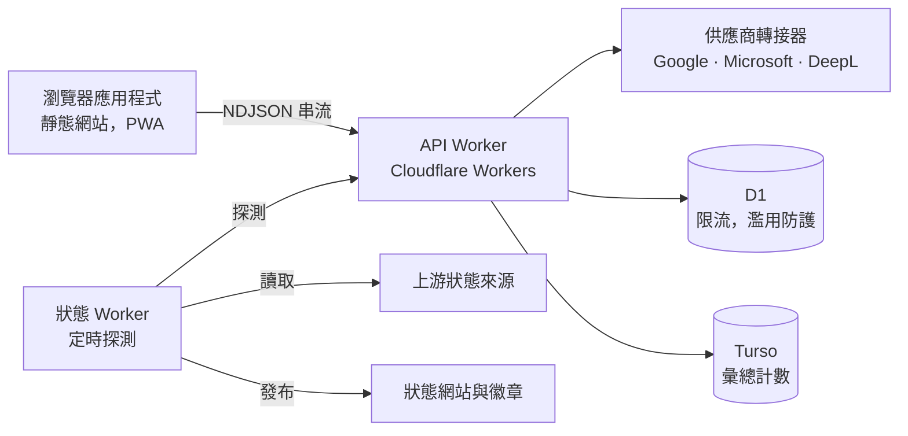

# 蒙太奇字幕翻譯器

**免費的線上字幕翻譯服務：依場景組織前後文，翻譯後精確還原到原有時間軸。**

<div align="right">

**[English](../../README.md) | [简体中文](./README.zh-Hans.md) | 繁體中文**

</div><br/>

<div align="center">

| [開啟工具](https://subs.js.org/subtitle-translator/) | [服務狀態](https://status.translate.sub.qzz.io) | [回報問題](https://github.com/MontageSubs/subtitle-translator/issues) | [參與討論](https://github.com/MontageSubs/subtitle-translator/discussions) |
| :---: | :---: | :---: | :---: |

[](https://status.translate.sub.qzz.io)
[](https://status.translate.sub.qzz.io)
[](https://status.translate.sub.qzz.io)
[](https://status.translate.sub.qzz.io)

</div><br/>

## 專案簡介

蒙太奇字幕翻譯器是由蒙太奇字幕社群開發的開源 Web 服務，支援 SRT、VTT、ASS/SSA 檔案，透過神經機器翻譯（NMT）引擎在 200 多種語言之間互譯，並將譯文還原到原有的時間軸上。

這個專案源自我們自己的字幕製作流程：純手工製作一部作品往往需要數週，而逐行機器翻譯會遺失前後文，譯文很難閱讀。因此它並不是人工精譯的替代品，目標是在沒有精譯時，盡快取得一份結構正確、可以閱讀的譯本。

選擇 NMT 而不是大型語言模型（LLM）的原因是成本：一份字幕檔平均約 1,500 行，若對每位使用者都使用 LLM，對免費、非營利的服務來說難以負擔。大部分工程投入集中在兩個問題上：讓引擎取得場景層級的前後文，以及將譯文還原到原有的字幕條目上。

## 運作原理

逐條翻譯會切斷跨越多條字幕的句子，引擎也看不到場景。處理流程分為四個步驟：

1. **解析與正規化。** 瀏覽器解析 SRT、VTT 或 ASS，分離時間軸、樣式標籤與文字，並偵測來源語言。
2. **合併與打包。** 屬於同一句話的字幕會被合併成自然語句，再依場景分組打包成批次，每個批次都帶有字幕條目標記。
3. **翻譯。** Worker 將批次交給翻譯供應商轉接器，並以 NDJSON 串流把進度回傳給前端。
4. **還原。** 依據標記把譯文重新切分回原有的字幕條目。標記受損時，由修復與重試策略接手。對於沒有詞語邊界的語言（中文、日文），則使用詞典斷詞來選擇切分位置。

詞彙表、選用的背景說明、換行規則與雙語排列，都圍繞這條主流程套用。

已知限制：

- 還原採用啟發式規則，遇到特殊句型時仍可能出現錯位切分或漏譯。
- 翻譯品質會因語言組合與供應商而異。
- ASS 輸出由解析後的事件重新產生，複雜的特效排版需要人工檢查。

## 架構



| 元件 | 路徑 | 技術堆疊 | 職責 |
| :--- | :--- | :--- | :--- |
| Web 應用程式 | `app/` | TypeScript、Vite，不使用 UI 框架 | 解析、渲染、歷史紀錄、國際化、文件、預先渲染靜態頁面 |
| API Worker | `workers/api/` | Cloudflare Workers、D1 | 打包、呼叫供應商、標記解析與復原、濫用防護 |
| 狀態 Worker | `workers/status/` | Cloudflare Workers、cron | 探測、事件判定、狀態頁面、徽章 |
| 文件 | `docs/` | Markdown，三種語言 | 建置時渲染進網站 |
| CI/CD | `.github/workflows/` | GitHub Actions | 部署、資料庫與金鑰維護 |

前端部署在 GitHub Pages，兩個 Worker 透過 GitHub Actions 使用 Wrangler 部署。

## 儲存庫結構

```
subtitle-translator/
├── app/
│   ├── src/
│   │   ├── api/translation/        # 串流協定用戶端、重試、存取驗證
│   │   ├── components/             # UI 元件
│   │   ├── lib/subtitle/
│   │   │   ├── formats/            # srt/、vtt/、ass/ 解析與渲染
│   │   │   ├── language/           # 文字系統分類、語言辨識
│   │   │   ├── postprocess/        # 換行與顯示文字
│   │   │   └── extraction/         # 編碼偵測與文字擷取
│   │   ├── lib/history/            # 本機翻譯歷史
│   │   ├── pages/                  # 翻譯器、歷史、文件、工具、關於、貢獻
│   │   ├── render/                 # 靜態頁面預先渲染
│   │   └── i18n/locales/           # en、zh-Hans、zh-Hant
│   ├── scripts/                    # 預先渲染、i18n 稽核、建置清單
│   └── vite-plugins/               # 文件管線、網站地圖、Web Manifest
├── workers/
│   ├── api/src/
│   │   ├── translation/engine/     # 打包、章節、字幕分塊、標記修復、復原
│   │   ├── translation/providers/  # google/、microsoft/、deepl/ 與註冊表
│   │   └── http/                   # NDJSON 串流、協定、輸出驗證
│   └── status/src/
│       ├── monitoring/             # 探測與上游狀態讀取
│       ├── arbitration/            # 元件狀態與事件判定
│       └── publish/                # 靜態頁面、資源、重新發布
├── docs/                           # 面向使用者的文件（en、zh-Hans、zh-Hant）
│   └── github/                     # 多語言 README，不會發布到網站
└── .github/workflows/
```

## 服務監控

狀態網站由 `workers/status` 產生。定時週期會收集探測結果與上游狀態來源，為每個元件判定狀態，發布靜態頁面並更新事件歷史。

- 狀態頁面：<https://status.translate.sub.qzz.io>
- 徽章列表：<https://status.translate.sub.qzz.io/badges/>
- 機器可讀快照：<https://status.translate.sub.qzz.io/status.json>

計畫內維護於 [`workers/status/MAINTENANCE.md`](../../workers/status/MAINTENANCE.md) 中宣告。API 與監控共用的錯誤碼請見 [`workers/status/docs/ERROR_CODES.md`](../../workers/status/docs/ERROR_CODES.md)。

## 本機開發

環境需求：Node.js 22 或更新版本。

```bash
git clone https://github.com/MontageSubs/subtitle-translator.git
cd subtitle-translator/app
npm ci
npm run dev
```

| 指令 | 用途 |
| :--- | :--- |
| `npm run dev` | 啟動 Vite 開發伺服器 |
| `npm run typecheck` | TypeScript 型別檢查 |
| `npm run i18n:check` | 檢查各語言的鍵、佔位符與複數形式是否一致 |
| `npm run build` | 型別檢查、i18n 稽核、打包、預先渲染、產生建置清單 |

Worker：

```bash
cd workers/api      # 或 workers/status
npm ci
npm run typecheck
npm run dev         # wrangler dev
```

`wrangler.toml` 中的 D1 資料庫 ID 是佔位符。金鑰與供應商憑證透過 Wrangler 或 GitHub Actions Secrets 設定，不在儲存庫內，因此在本機執行 Worker 需要你自己的綁定。

提交 Pull Request 之前，請在 `app/` 執行 `npm run build`，並對修改過的 Worker 執行 `npm run typecheck`。

## 參與貢獻

最需要協助的方向：

- **語言處理。** 文字系統分類位於 `app/src/lib/subtitle/language/families/`。歡迎補充更多語言的斷詞與換行規則，尤其是附上目前處理失敗的真實字幕樣本。
- **還原錯誤。** 請附上原始字幕檔、目標語言、設定截圖與翻譯日誌，這樣的回報最容易定位，詳見[意見回饋](../feedback/zh-Hant.md)。
- **翻譯供應商。** 轉接器實作 `TranslationProvider` 介面，並在 `workers/api/src/translation/providers/registry.ts` 中註冊。
- **在地化。** 介面文字位於 `app/src/i18n/locales/`，`npm run i18n:check` 會回報缺少的鍵與佔位符不一致。
- **文件。** `docs/` 下的 Markdown 由相容 GitHub 風格的管線渲染。每份文件每種語言一個檔案，並登錄在 `docs/manifest.yml` 中。
- **狀態監控。** `workers/status/` 中的探測、上游讀取與事件範本。

較大的修改請先開 Issue 討論。更多參與方式請見[如何貢獻](../contribute/zh-Hant.md)，使用者資料的處理方式請見[隱私權政策](../privacy/zh-Hant.md)。

## 授權條款

[MIT](../../LICENSE)

---

<div align="center">

**蒙太奇字幕社群 · MontageSubs**  
「用愛發電 ❤️ Powered by Love」

</div>
