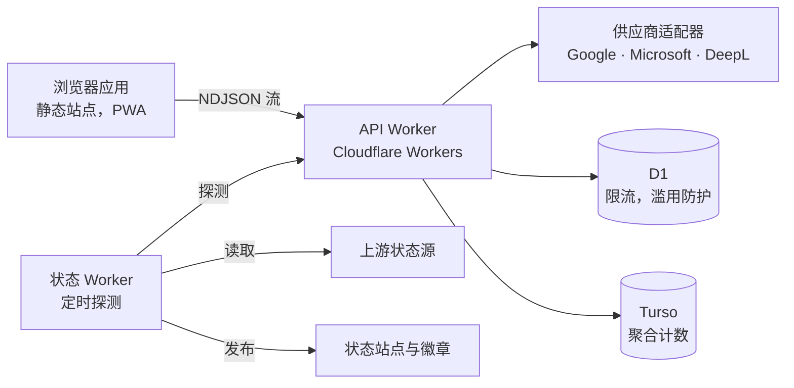

# 蒙太奇字幕翻译器


**免费开源的在线字幕翻译器，支持 SRT、VTT、ASS，无需注册，由蒙太奇字幕社区制作。**

<div align="right">

**[English](../../../README.md) | 简体中文 | [繁體中文](./zh-Hant.md)**

</div><br/>

<div align="center">

| [打开工具](https://subs.js.org/subtitle-translator/) | [反馈问题](https://github.com/MontageSubs/subtitle-translator/issues) | [参与讨论](https://github.com/MontageSubs/subtitle-translator/discussions) |
| :---: | :---: | :---: |

</div><br/>

## 项目简介

蒙太奇字幕翻译器是蒙太奇字幕社区（MontageSubs）做的免费开源字幕翻译器，不用注册。它用神经机器翻译（NMT）引擎，以场景为单位翻译 SRT、VTT、ASS/SSA 字幕，支持 200 多种语言，再把译文原样放回原来的时间轴。

做它是为了补上我们自己工作流里的缺口：手工做一部片子的字幕要好几周，而逐行机翻丢掉太多上下文，读起来不成句。它不是人工翻译的替代品，目标是快速给出结构正确、读得通的初稿。

为什么用 NMT 而不用大语言模型（LLM）：一个字幕文件通常有 1,500 条左右，让每位用户都走 LLM，对免费的非营利服务来说负担不起。所以我们把功夫都花在了引擎前后，项目里大部分代码也在这里。

## 工作原理

逐条翻译会把跨越多条字幕的句子切断，引擎也看不到场景。流程分四步来绕开这个问题：

1. **解析与规范化。** 浏览器解析 SRT、VTT 或 ASS，把时间轴、样式标签和文本分开，并识别源语言。
2. **合并与打包。** 属于同一句话的字幕先合并成自然的语句，再按场景分组打包成批次，每个批次带着字幕条目标记。
3. **翻译。** Worker 把批次交给翻译供应商适配器，并以 NDJSON 流把进度回传给前端。
4. **还原。** 按标记把译文重新切回原来的字幕条目。标记受损时，由修复与重试策略接手。中文、日文这类没有词边界的语言，用词典分词来选切分位置。

术语表、可选的背景说明、换行规则和双语排列，都围绕这条主线运作。

## 我们做了什么

翻译引擎只会返回一段文字。把它变成能直接放进播放器的字幕文件，才是难的部分，我们大部分精力都花在这里。下面这些都是我们自己做的，全部开源。

### 场景级翻译

字幕条目先按行尾标点、引号状态、对白破折号、音乐行和续句规则合并成完整的句子，再按时间戳之间的间隔把句子打包成场景，每个场景作为一段连贯的文字交给引擎。时间轴和样式不会进入引擎，发出去的只有文本和轻量的条目标记。应用里有个滑块，调的是场景切得多细，在上下文和速度之间取舍。

### 引擎不得不听的术语表

不少 NMT 引擎不理会术语表，或者只有部分接口版本才生效。我们用标记保护术语，让它们在一来一回中不被改动，译文里落下的就是你写的那个译法。单独成条的术语直接解析。术语表可以区分大小写，能导入导出，也能从本地历史里沿用以前的。对中文用户来说，这就是人名地名每集译法都不一样那个老问题的解法。

### 在你的设备上认人名

英译中、日译中、译成俄语这类人名写法会变的语言对，翻译前可以先把人物和地名找出来。浏览器里跑一个小型命名实体模型，用 ONNX Runtime Web，有 WebGPU 就用 WebGPU，再配上从字幕文本建出来的词表。识别分七档深度，可以暂停，也能从断点接着跑，说话人标注会被当作额外线索。找到的名字一次性翻译好，作为术语表交给你过目。识别这一步在本机完成，发出去翻译的只有人名本身。模型是可选下载，在“模型”页管理。

### 把译文放回原来的字幕条目

引擎返回的是一个个长句，每一句都得切成合适原字幕条目的小段。标记还在，就按标记切。标记靠不住时，把原文标点和译文做序列对齐来定位，并按显示宽度加权，全角和半角文字才分得公平。带单位的数字、引号里的对白、书名号、样式标签、括号和术语表词条都是受保护的片段，不会被切开。切得过重或过轻的条目会重新平衡，避头尾规则保证不该出现在行首行尾的字符不会出现在那里。中文和日文的断点，由词典分词来挑。

### 会自己修复的流程

引擎总会出状况：丢标记、在标记里塞空格、留下没翻的原文，或者让拉丁字母的片段漏进译文。每一份返回都会校验，损坏的标记原地修复。修不了的，进入分级恢复：先补缺失的条目，再处理没翻译的，然后用逐步缩小的上下文窗口重试可疑段落，接着逐条重试，最后清理残留的源语言片段。重试是推测性地并行进行的。

## 功能一览

- **输入。** 支持 SRT、VTT、ASS、SSA，可一次放入多个文件、文件夹或 ZIP，自动检测编码。能直接在浏览器里从 MKV 视频读出字幕，视频本身不会上传。
- **源字幕整理。** 双语字幕可以拆出你要的那一种语言，多轨文件可以挑选版本，SDH 听障标注可以去掉，歌词则保留原文。
- **输出。** 单语或双语输出，叠放顺序和条目布局由你定。ASS 样式按平台选字体，标点、空格和换行遵循各语言的习惯，从右向左的文字有双向保护。
- **校对。** 对照视图，带查找替换和撤销的条目编辑器，还会按各语言自己的阈值，自动标出漏译、残留原文、过长的行和语速过快的字幕。
- **你的数据。** 历史记录和下载的模型都留在你的浏览器里。界面有 30 种语言，也可以装成 PWA。

## 已知局限

- 还原基于启发式规则，遇到特殊句式时仍可能出现错位切分或遗漏翻译。
- 翻译质量因语言对和供应商而异。
- ASS 输出由解析后的事件重新生成，复杂特效排版需要人工检查。

## 架构



| 组成部分 | 路径 | 技术栈 | 职责 |
| :--- | :--- | :--- | :--- |
| Web 应用 | `app/` | TypeScript、Vite，不使用 UI 框架 | 解析、渲染、历史记录、国际化、文档、预渲染静态页面 |
| API Worker | `workers/api/` | Cloudflare Workers、D1 | 打包、调用供应商、标记解析与恢复、滥用防护 |
| 状态 Worker | `workers/status/` | Cloudflare Workers、cron | 探测、事件裁定、状态页面、徽章 |
| 文档 | `docs/` | Markdown，三种语言 | 构建时渲染进站点 |
| CI/CD | `.github/workflows/` | GitHub Actions | 部署、数据库与密钥维护 |

前端部署在 GitHub Pages，两个 Worker 通过 GitHub Actions 使用 Wrangler 部署。


## 仓库结构

```
subtitle-translator/
├── app/
│   ├── src/
│   │   ├── api/translation/        # 流式协议客户端、重试、访问挑战
│   │   ├── components/             # UI 组件，包括校对与编辑弹窗
│   │   ├── lib/subtitle/
│   │   │   ├── formats/            # srt/、vtt/、ass/ 的解析器与渲染器
│   │   │   ├── container/matroska/ # 浏览器内提取 MKV 字幕
│   │   │   ├── language/           # 文字体系、语言规则、SDH 规则
│   │   │   ├── bilingual/          # 双语字幕检测与拆分
│   │   │   ├── variants/           # 多轨变体、SDH 推断
│   │   │   ├── sentence/           # 前端的句子合并
│   │   │   ├── postprocess/        # 换行、排版、双向文字保护
│   │   │   └── extraction/         # 编码检测与文本提取
│   │   ├── lib/entities/           # 本机人名识别与术语规划
│   │   ├── lib/models/             # 可选模型的下载、运行时与存储
│   │   ├── lib/history/            # 本地翻译历史
│   │   ├── model-catalog/          # 模型描述文件
│   │   ├── pages/                  # 翻译、历史、模型、文档、工具、关于、贡献
│   │   ├── render/                 # 静态页面预渲染
│   │   └── i18n/locales/           # 30 种界面语言
│   ├── scripts/                    # 预渲染、i18n 审计、构建清单
│   ├── version.json                # 应用版本号的唯一来源
│   └── vite-plugins/               # 渠道、Service Worker、404 页面、文档管线、站点地图、Web 清单
├── workers/
│   ├── api/src/
│   │   ├── subtitle/extract/       # 句子合并、场景单元、术语提取
│   │   ├── subtitle/merge/         # 锚点、切点决策、译文拆分、重平衡
│   │   ├── translation/engine/     # 打包、章节、条目分块、术语标记、标记修复、恢复
│   │   ├── translation/terms/      # 识别出的人名与术语的翻译
│   │   ├── translation/providers/  # google/、microsoft/、deepl/ 及注册表
│   │   └── http/                   # NDJSON 流、协议、输出防护
│   └── status/src/
│       ├── monitoring/             # 探测与上游状态读取
│       ├── arbitration/            # 组件状态与事件裁定
│       └── publish/                # 静态页面、资源、重新发布
├── docs/                           # 面向用户的文档（en、zh-Hans、zh-Hant）
│   └── github/readme/              # 各语言 README，不会发布到站点
└── .github/workflows/
```

## 发布渠道

`main` 构建正式渠道，`beta` 从同一份源码构建测试渠道。渠道由构建时的 `APP_CHANNEL` 决定，与分支名无关。一次 Pages 部署同时包含两个版本：正式版在站点根目录，测试版在 `beta/` 下。

两个渠道各有各的存储命名空间（`localStorage`、`sessionStorage`、IndexedDB）、Service Worker 作用域和缓存，所以更新、回滚和用户数据都不会串到对方那里。测试版的版本号显示为 `<version>-beta`，页脚有一颗紫色的心，连点五下可以在两个渠道之间切换。测试版页面带 `noindex`，不在站点地图里，正式版页面也不会链接到它。

部署始终从 `main` 发起，两个渠道一起发布。向 `main` 或 `beta` 推送且改动涉及 `app/` 时，会先递增该分支的 `app/version.json`，附上 `Source:` 引用提交回去，再部署；推送到 `beta` 时，部署交给 `main` 完成，因为 `github-pages` 环境只接受 `main`。正式版资源带内容哈希，构建结果是确定的，所以只改了测试版并不会让正式版用户被迫更新。测试版构建失败时，正式版保持已部署的状态，这次运行会标红。

## 服务监控

状态站点由 `workers/status` 生成。定时周期会收集探测结果和上游状态源，为每个组件裁定状态，发布静态页面并更新事件历史。

- 状态页面：<https://status.sub.qzz.io>
- 徽章列表：<https://status.sub.qzz.io/badges/>
- 机器可读快照：<https://status.sub.qzz.io/status.json>

计划内维护在 [`workers/status/MAINTENANCE.md`](../../../workers/status/MAINTENANCE.md) 中声明。API 与监控共用的错误码见 [`workers/status/docs/ERROR_CODES.md`](../../../workers/status/docs/ERROR_CODES.md)。

## 本地开发

环境要求：Node.js 22 或更高版本。

```bash
git clone https://github.com/MontageSubs/subtitle-translator.git
cd subtitle-translator/app
npm ci
npm run dev
```

| 命令 | 作用 |
| :--- | :--- |
| `npm run dev` | 启动 Vite 开发服务器 |
| `npm run typecheck` | TypeScript 类型检查 |
| `npm run i18n:check` | 校验各语言的键、占位符与复数形式是否一致 |
| `npm run build` | 类型检查、i18n 审计、打包、预渲染，并为 `APP_CHANNEL` 指定的渠道生成构建清单（默认 `production`，输出到 `dist/`） |
| `APP_CHANNEL=beta npm run build` | 构建测试渠道，输出到 `dist-beta/`，部署在 `<base>/beta/` 下 |

Worker：

```bash
cd workers/api      # 或 workers/status
npm ci
npm run typecheck
```

Worker 不包含任何部署值。CI 会在部署时根据仓库 Secrets 生成 Wrangler 配置。

提交 Pull Request 之前，请在 `app/` 运行 `npm run build`，并对改动过的 Worker 运行 `npm run typecheck`。

## 参与贡献

欢迎加入。项目采用 MIT 许可证，所有部分都是开放的：应用、翻译引擎、状态监控和文档。最需要帮手的地方有：

- **语言处理。** 文字体系分类位于 `app/src/lib/subtitle/language/families/`。欢迎补充更多语言的分词与换行规则，尤其是附带目前处理失败的真实字幕样本。
- **还原错误。** 请附上原始字幕文件、目标语言、设置截图和翻译日志，这样的反馈最容易定位，详见[反馈指南](../../feedback/zh-Hans.md)。
- **翻译供应商。** 适配器实现 `TranslationProvider` 接口，并在 `workers/api/src/translation/providers/registry.ts` 中注册。
- **本地化。** 界面在 [Weblate](https://hosted.weblate.org/projects/subtitle-translator/web-interface/) 和 [Crowdin](https://crowdin.com/project/montage-subtitle-translator) 上翻译，不会写代码也能参与。感谢这两个平台对开源项目的支持。怎么上手，请看[本地化指南](../../localization/zh-Hans.md)。
- **文档。** `docs/` 下的 Markdown 由兼容 GitHub 风格的管线渲染。每份文档每种语言一个文件，并登记在 `docs/manifest.yml` 中。
- **状态监控。** `workers/status/` 中的探测、上游读取与事件模板。

较大的改动请先开 Issue 讨论。更多参与方式见[如何贡献](../../contribute/zh-Hans.md)，有问题也欢迎来[社区](../../community/zh-Hans.md)聊。用户数据的处理方式见[隐私政策](../../privacy/zh-Hans.md)。无障碍方面的反馈同样欢迎，见[无障碍声明（英文）](../../ACCESSIBILITY.md)。参与社区请遵守[行为准则](../../code-of-conduct/zh-Hans.md)；安全问题请按[安全漏洞报告指南](../../security/zh-Hans.md)私下报告。

## 许可证

[MIT](../../../LICENSE)

---

<div align="center">

**蒙太奇字幕社区 · MontageSubs**  
“用爱发电 ❤️ Powered by Love”

</div>
