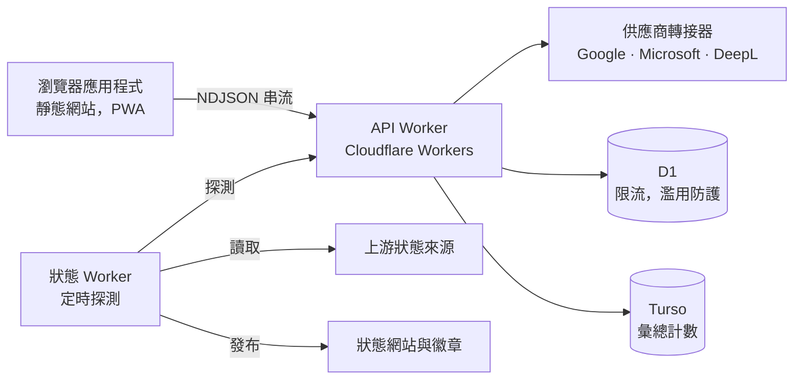

# 蒙太奇字幕翻譯器


**免費開源的線上字幕翻譯器，支援 SRT、VTT、ASS，無須註冊，由蒙太奇字幕社群製作。**

<div align="right">

**[English](../../../README.md) | [简体中文](./zh-Hans.md) | 繁體中文**

</div><br/>

<div align="center">

| [開啟工具](https://subs.js.org/subtitle-translator/) | [回報問題](https://github.com/MontageSubs/subtitle-translator/issues) | [參與討論](https://github.com/MontageSubs/subtitle-translator/discussions) |
| :---: | :---: | :---: |

</div><br/>

## 專案簡介

蒙太奇字幕翻譯器是蒙太奇字幕社群（MontageSubs）製作的免費開源字幕翻譯器，不需要註冊。它使用神經機器翻譯（NMT）引擎，以場景為單位翻譯 SRT、VTT、ASS/SSA 字幕，支援 200 多種語言，再把譯文原封不動放回原本的時間軸。

做這個專案，是為了補上我們自己工作流程中的缺口：人工製作一部作品的字幕要花上好幾個星期，而逐行機器翻譯會丟掉太多前後文，讀起來不成句。它不是人工翻譯的替代品，目標是在短時間內給出結構正確、讀得通的初稿。

為什麼選擇 NMT 而不是大型語言模型（LLM）：一份字幕檔通常有 1,500 條左右，讓每位使用者都走 LLM，對免費的非營利服務而言負擔不起。所以我們把心力放在引擎的前後，專案裡大部分程式碼也在這裡。

## 運作原理

逐條翻譯會把跨越多條字幕的句子切斷，引擎也看不到場景。流程分成四個步驟來解決這個問題：

1. **解析與正規化。** 瀏覽器解析 SRT、VTT 或 ASS，把時間軸、樣式標籤與文字分開，並偵測來源語言。
2. **合併與打包。** 屬於同一句話的字幕先合併成自然的語句，再依場景分組打包成批次，每個批次都帶有字幕條目標記。
3. **翻譯。** Worker 把批次交給翻譯供應商轉接器，並以 NDJSON 串流把進度回傳給前端。
4. **還原。** 依據標記把譯文重新切回原本的字幕條目。標記受損時，由修復與重試機制接手。中文、日文這類沒有詞彙邊界的語言，則使用詞典斷詞來選擇切分位置。

詞彙表、選用的背景說明、換行規則與雙語排列，都圍繞著這條主線運作。

## 我們做了什麼

翻譯引擎只會回傳一段文字。要把它變成能直接放進播放器的字幕檔，才是困難的部分，我們多數的心力都花在這裡。下面這些都是我們自己做的，而且全部開源。

### 場景級翻譯

字幕條目會先依行尾標點、引號狀態、對白破折號、音樂行與續句規則，合併成完整的句子，再依時間戳之間的間隔把句子打包成場景，每個場景會作為一段連貫的文字送給引擎。時間軸與樣式不會進入引擎，送出去的只有文字與輕量的條目標記。應用程式裡有個滑桿，調整的是場景切得多細，在前後文與速度之間取捨。

### 引擎不得不遵守的詞彙表

不少 NMT 引擎不理會詞彙表，或只有部分 API 版本才會生效。我們用標記保護詞彙，讓它們在一來一回之間不被改動，譯文裡留下的就是你寫的那個譯法。單獨成條的詞彙會直接解析。詞彙表可以區分大小寫、能匯入匯出，也能從本機記錄中沿用先前的內容。

### 在你的裝置上辨識人名

英翻中、日翻中、翻成俄文這類人名寫法會改變的語言組合，翻譯前可以先把人物與地名找出來。瀏覽器裡執行一個小型的命名實體模型，透過 ONNX Runtime Web，有 WebGPU 就用 WebGPU，再搭配由字幕文字建立的詞表。辨識分成七個深度，可以暫停，也能從中斷點繼續，說話者標註會被當作額外線索。找到的名字會一次翻譯完成，並以詞彙表的形式交給你確認。辨識這一步在本機完成，送出去翻譯的只有人名本身。模型是選用下載，在「模型」頁面管理。

### 把譯文放回原本的字幕條目

引擎回傳的是一個個長句，每一句都得切成適合原本字幕條目的小段。標記還在的話，就依標記切分。標記不可靠時，則把原文標點與譯文做序列比對來定位，並依顯示寬度加權，全形與半形文字才分得公平。附單位的數字、引號內的對白、書名號、樣式標籤、括號與詞彙表詞條都屬於受保護的片段，不會被切開。切得過重或過輕的條目會重新平衡，避頭尾規則則確保不該出現在行首行尾的字元不會出現在那裡。中文與日文的斷點，由詞典斷詞來挑選。

### 會自己修復的流程

引擎總會出狀況：弄丟標記、在標記裡塞進空格、留下沒翻的原文，或讓拉丁字母的片段混進譯文。每一份回應都會經過驗證，損壞的標記會就地修復。修不了的，進入分級復原：先補上缺漏的條目，再處理未翻譯的，接著用逐步縮小的前後文視窗重試可疑段落，然後逐條重試，最後清理殘留的來源語言片段。重試是以推測方式並行進行的。

## 功能一覽

- **輸入。** 支援 SRT、VTT、ASS、SSA，可一次放入多個檔案、資料夾或 ZIP，並自動偵測編碼。可以直接在瀏覽器裡從 MKV 影片讀出字幕，影片本身不會上傳。
- **來源字幕整理。** 雙語字幕可以拆出你要的那一種語言，多軌檔案可以挑選版本，SDH 聽障標註可以移除，歌詞則保留原文。
- **輸出。** 單語或雙語輸出，疊放順序與條目版面由你決定。ASS 樣式會依平台挑選字型，標點、空格與換行遵循各語言的習慣，由右至左的文字也有雙向保護。
- **校對。** 對照檢視、附尋找與取代和復原功能的條目編輯器，並依各語言自己的門檻，自動標出漏譯、殘留原文、過長的行，以及語速過快的字幕。
- **你的資料。** 記錄與下載的模型都留在你的瀏覽器裡。介面提供 30 種語言，也可以安裝成 PWA。

## 已知限制

- 還原依靠啟發式規則，遇到特殊句型時仍可能出現切分錯位或漏譯。
- 翻譯品質會因語言組合與供應商而異。
- ASS 輸出由解析後的事件重新產生，複雜的特效排版需要人工檢查。

## 架構



| 元件 | 路徑 | 技術堆疊 | 職責 |
| :--- | :--- | :--- | :--- |
| Web 應用程式 | `app/` | TypeScript、Vite，不使用 UI 框架 | 解析、渲染、歷史紀錄、國際化、文件、預先渲染靜態頁面 |
| API Worker | `workers/api/` | Cloudflare Workers、D1 | 打包、呼叫供應商、標記解析與復原、濫用防護 |
| 狀態 Worker | `workers/status/` | Cloudflare Workers、cron | 探測、事件判定、狀態頁面、徽章 |
| 文件 | `docs/` | Markdown，三種語言 | 建置時渲染進網站 |
| CI/CD | `.github/workflows/` | GitHub Actions | 部署、資料庫與金鑰維護 |

前端部署在 GitHub Pages，兩個 Worker 透過 GitHub Actions 使用 Wrangler 部署。


## 儲存庫結構

```
subtitle-translator/
├── app/
│   ├── src/
│   │   ├── api/translation/        # 串流協定用戶端、重試、存取挑戰
│   │   ├── components/             # UI 元件，包括校對與編輯視窗
│   │   ├── lib/subtitle/
│   │   │   ├── formats/            # srt/、vtt/、ass/ 的解析器與渲染器
│   │   │   ├── container/matroska/ # 瀏覽器內擷取 MKV 字幕
│   │   │   ├── language/           # 文字系統、語言規則、SDH 規則
│   │   │   ├── bilingual/          # 雙語字幕偵測與拆分
│   │   │   ├── variants/           # 多軌變體、SDH 推斷
│   │   │   ├── sentence/           # 前端的句子合併
│   │   │   ├── postprocess/        # 換行、排版、雙向文字保護
│   │   │   └── extraction/         # 編碼偵測與文字擷取
│   │   ├── lib/entities/           # 本機人名辨識與詞彙規劃
│   │   ├── lib/models/             # 選用模型的下載、執行環境與儲存
│   │   ├── lib/history/            # 本機翻譯記錄
│   │   ├── model-catalog/          # 模型描述檔
│   │   ├── pages/                  # 翻譯、記錄、模型、文件、工具、關於、貢獻
│   │   ├── render/                 # 靜態頁面預先渲染
│   │   └── i18n/locales/           # 30 種介面語言
│   ├── scripts/                    # 預先渲染、i18n 稽核、建置清單
│   ├── version.json                # 應用程式版本號的唯一來源
│   └── vite-plugins/               # 管道、Service Worker、404 頁面、文件管線、網站地圖、Web 資訊清單
├── workers/
│   ├── api/src/
│   │   ├── subtitle/extract/       # 句子合併、場景單元、詞彙擷取
│   │   ├── subtitle/merge/         # 錨點、切點決策、譯文拆分、重新平衡
│   │   ├── translation/engine/     # 打包、章節、條目分塊、詞彙標記、標記修復、復原
│   │   ├── translation/terms/      # 辨識出的人名與詞彙的翻譯
│   │   ├── translation/providers/  # google/、microsoft/、deepl/ 與註冊表
│   │   └── http/                   # NDJSON 串流、協定、輸出防護
│   └── status/src/
│       ├── monitoring/             # 探測與上游狀態讀取
│       ├── arbitration/            # 元件狀態與事件裁定
│       └── publish/                # 靜態頁面、資源、重新發布
├── docs/                           # 面向使用者的文件（en、zh-Hans、zh-Hant）
│   └── github/readme/              # 各語言 README，不會發布到網站
└── .github/workflows/
```

## 發布管道

`main` 建置正式管道，`beta` 則以同一份原始碼建置測試管道。管道由建置時的 `APP_CHANNEL` 決定，與分支名稱無關。一次 Pages 部署同時包含兩個版本：正式版在網站根目錄，測試版在 `beta/` 底下。

兩個管道各有自己的儲存命名空間（`localStorage`、`sessionStorage`、IndexedDB）、Service Worker 範圍與快取，所以更新、回復與使用者資料都不會互相干擾。測試版的版本號顯示為 `<version>-beta`，頁尾有一顆紫色的心，連點五下就能在兩個管道之間切換。測試版頁面帶有 `noindex`，不在網站地圖裡，正式版頁面也不會連結過去。

部署一律從 `main` 發起，兩個管道一起發布。推送到 `main` 或 `beta` 且變更涉及 `app/` 時，會先遞增該分支的 `app/version.json`，附上 `Source:` 參照後提交回去，再進行部署；推送到 `beta` 時，部署會交給 `main` 完成，因為 `github-pages` 環境只接受 `main`。正式版資源帶有內容雜湊，建置結果是確定的，所以只改了測試版，並不會讓正式版使用者被迫更新。測試版建置失敗時，正式版維持已部署的狀態，該次執行會顯示紅燈。

## 服務監控

狀態網站由 `workers/status` 產生。定時週期會收集探測結果與上游狀態來源，為每個元件判定狀態，發布靜態頁面並更新事件歷史。

- 狀態頁面：<https://status.sub.qzz.io>
- 徽章列表：<https://status.sub.qzz.io/badges/>
- 機器可讀快照：<https://status.sub.qzz.io/status.json>

計畫內維護於 [`workers/status/MAINTENANCE.md`](../../../workers/status/MAINTENANCE.md) 中宣告。API 與監控共用的錯誤碼請見 [`workers/status/docs/ERROR_CODES.md`](../../../workers/status/docs/ERROR_CODES.md)。

## 本機開發

環境需求：Node.js 22 或更新版本。

```bash
git clone https://github.com/MontageSubs/subtitle-translator.git
cd subtitle-translator/app
npm ci
npm run dev
```

| 指令 | 用途 |
| :--- | :--- |
| `npm run dev` | 啟動 Vite 開發伺服器 |
| `npm run typecheck` | TypeScript 型別檢查 |
| `npm run i18n:check` | 檢查各語言的鍵、佔位符與複數形式是否一致 |
| `npm run build` | 型別檢查、i18n 稽核、打包、預先渲染，並為 `APP_CHANNEL` 指定的管道產生建置清單（預設 `production`，輸出到 `dist/`） |
| `APP_CHANNEL=beta npm run build` | 建置測試管道，輸出到 `dist-beta/`，部署在 `<base>/beta/` 底下 |

Worker：

```bash
cd workers/api      # 或 workers/status
npm ci
npm run typecheck
```

Worker 不包含任何部署值。CI 會在部署時根據儲存庫 Secrets 產生 Wrangler 設定。

提交 Pull Request 之前，請在 `app/` 執行 `npm run build`，並對修改過的 Worker 執行 `npm run typecheck`。

## 參與貢獻

歡迎加入。專案採用 MIT 授權，所有部分都是公開的：應用程式、翻譯引擎、狀態監控與文件。最需要幫手的地方有：

- **語言處理。** 文字系統分類位於 `app/src/lib/subtitle/language/families/`。歡迎補充更多語言的斷詞與換行規則，尤其是附上目前處理失敗的真實字幕樣本。
- **還原錯誤。** 請附上原始字幕檔、目標語言、設定畫面截圖與翻譯日誌，這樣的回報最容易定位，詳見[回報指南](../../feedback/zh-Hant.md)。
- **翻譯供應商。** 轉接器實作 `TranslationProvider` 介面，並在 `workers/api/src/translation/providers/registry.ts` 中註冊。
- **在地化。** 介面在 [Weblate](https://hosted.weblate.org/projects/subtitle-translator/web-interface/) 與 [Crowdin](https://crowdin.com/project/montage-subtitle-translator) 上翻譯，不會寫程式也能參與。感謝這兩個平台對開源專案的支持。想知道怎麼開始，請看[在地化指南](../../localization/zh-Hant.md)。
- **文件。** `docs/` 底下的 Markdown 由相容 GitHub 風格的管線渲染。每份文件每種語言一個檔案，並登記在 `docs/manifest.yml` 中。
- **狀態監控。** `workers/status/` 中的探測、上游讀取與事件範本。

較大的改動請先開 Issue 討論。更多參與方式請見[如何貢獻](../../contribute/zh-Hant.md)，有問題也歡迎來[社群](../../community/zh-Hant.md)聊聊。使用者資料的處理方式請見[隱私權政策](../../privacy/zh-Hant.md)。無障礙方面的回饋同樣歡迎，請見[無障礙聲明（英文）](../../ACCESSIBILITY.md)。參與社群請遵守[行為準則](../../code-of-conduct/zh-Hant.md)；安全問題請依[安全漏洞回報指南](../../security/zh-Hant.md)私下回報。

## 授權條款

[MIT](../../../LICENSE)

---

<div align="center">

**蒙太奇字幕社群 · MontageSubs**  
「用愛發電 ❤️ Powered by Love」

</div>
